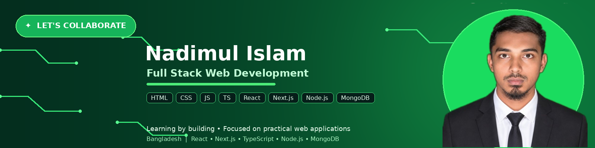

 

---

## 👋 Hey! Nice to see you.

Welcome to my GitHub page!

I'm **Nadimul Islam**, a Diploma in Engineering student from Bangladesh, focused on learning modern web development and building practical projects. I'm growing my skills across the frontend and backend, from responsive user interfaces to APIs and databases.

## 🧰 Technologies I Work With

## 🌱 What I'm working on

- Building modern web interfaces with **React, Next.js, and TypeScript**.
- Practicing REST APIs, server-side logic, and CRUD operations.
- Learning to connect frontend applications with **Node.js, Express.js, and MongoDB**.
- Improving responsive design, code organization, debugging, and project structure.
- Exploring AI-powered web applications as a future direction.

## 🚀 Open-source & personal projects

> Replace the example repository names below with the exact repository names from your GitHub account. The cards and links will then show your real projects.

| 🎁 Project | 🛠️ Tech | 📌 What it is |
|:--|:--|:--|
| [BazarDor](https://github.com/YOUR_GITHUB_USERNAME/YOUR_BAZARDOR_REPO) | Next.js · TypeScript | Market-price application focused on product information and responsive UI. |
| [DevStack Builder](https://github.com/YOUR_GITHUB_USERNAME/YOUR_DEVSTACK_REPO) | React · TypeScript · Vite | Frontend practice project focused on reusable UI and responsive layouts. |
| [Backend API Practice](https://github.com/YOUR_GITHUB_USERNAME/YOUR_BACKEND_REPO) | Node.js · Express · MongoDB | Practice with REST endpoints, database queries, and CRUD operations. |

## 📊 GitHub overview

 

  

  

## ✍️ Latest posts

I haven't added a public developer-blog feed yet. When you start publishing technical articles on DEV.to, Medium, or your own blog, this section can be connected to update automatically using GitHub Actions.

## 🤝 Where to find me

<!-- Replace the placeholder below with your real LinkedIn profile URL, or remove it if you don't use LinkedIn. -->

<!-- Replace YOUR_EMAIL with an email address you are comfortable making public, or remove this badge. -->

---

**Learning consistently · Building practically · Improving every day**

